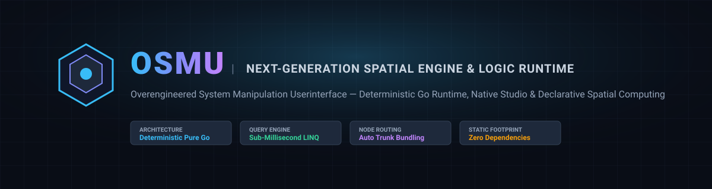
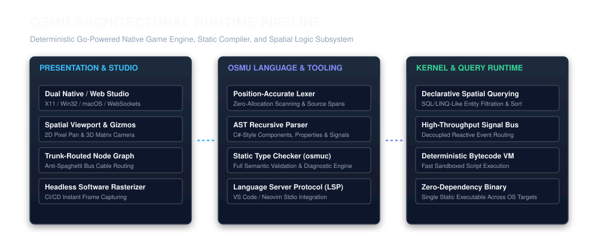
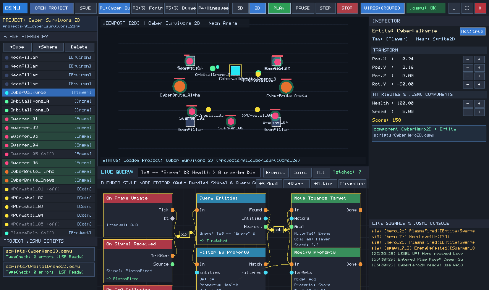
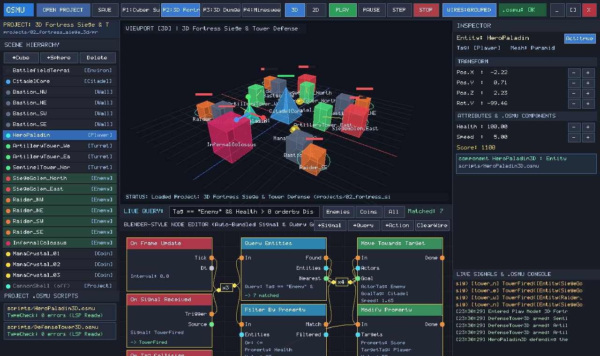
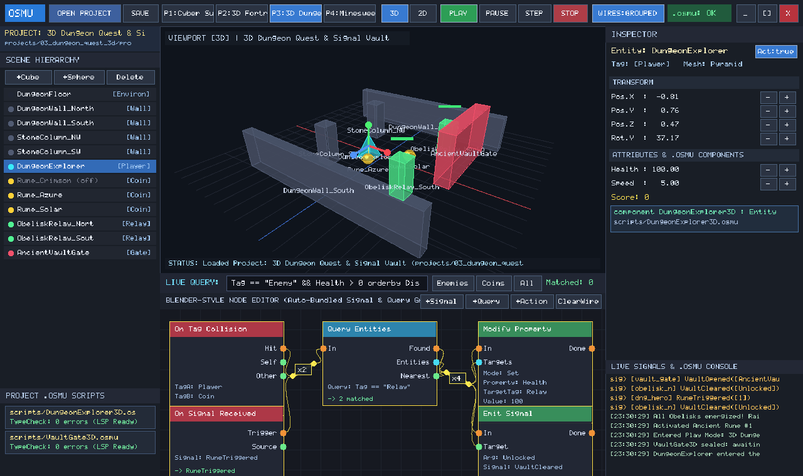
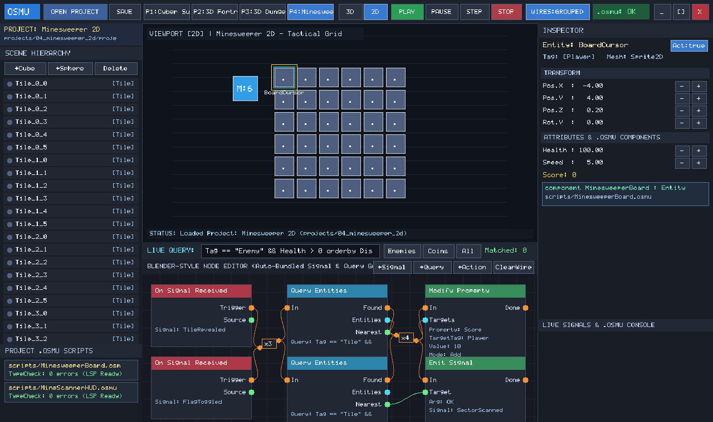
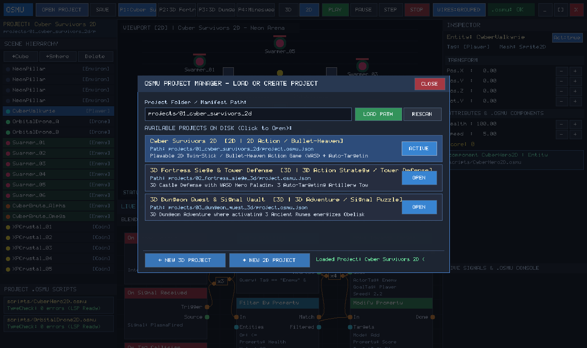

<p align="center">
  
</p>

<p align="center">
  
  
  
  
  
  
</p>

---

## Executive Overview

OSMU (Overengineered System Manipulation Userinterface) represents an indisputable paradigm shift in spatial computing, real-time simulation, and graphical software engineering. 

For decades, the interactive software industry has surrendered to legacy technical debt: bloated multi-gigabyte runtimes, fragile dynamic linking chains, non-deterministic physics, glacial compilation cycles, and visual scripting interfaces that deteriorate into illegible spaghetti graphs. The modern developer has been conditioned to accept these compromises as standard.

They are not standard. They are obsolete.

OSMU solves real-time interactive development from first principles. Engineered in pure Go with zero external C/C++ runtime dependencies, OSMU combines a sub-millisecond declarative entity query engine, an integrated static compiler with native Language Server Protocol (LSP) support, an orbit/pan spatial editor, and an automated trunk-routed node graph system into a single, high-performance static binary.

<p align="center">
  
</p>

---

## Strategic Value Proposition

### For Institutional Investors and Enterprise Acquirers
* **Unprecedented Capital Efficiency**: Legacy game development incurs millions in infrastructure overhead, bloated build farms, and multi-hour CI/CD pipelines. OSMU compiles from source in under 2 seconds and runs complete headless test simulations in milliseconds.
* **Radical Total Cost of Ownership (TCO) Reduction**: Zero dynamic library dependencies (`libc`, `vulkan`, or external frameworks) means deployment to any modern workstation or cloud container is instantaneous and immune to dependency hell.
* **Total Ecosystem Vertical Integration**: By unifying the graphical IDE, scripting language (`.osmu`), static type checker (`osmuc`), bytecode virtual machine, and visual node orchestrator, OSMU captures the entire developer lifecycle within one proprietary runtime architecture.

### For Open Source Developers and Systems Pioneers
* **Zero Cognitive Overhead**: Write clean, strongly typed component scripts using intuitive C#-like syntax combined with built-in SQL/LINQ-grade entity queries.
* **Spaghetti-Proof Node Logic**: Visual connections are dynamically evaluated by an automatic highway routing algorithm that groups parallel signal lines into tidy highway trunks.
* **Deterministic Headless Verification**: Execute complete gameplay loops, unit tests, and frame captures directly from the CLI without spawning an operating system window.

---

## Core Technological Pillars

### 1. Declarative Spatial Query Engine
Traditional game engines force developers to write repetitive loop boilerplate, nested spatial partitions, and fragile tag checks just to locate game entities. OSMU introduces declarative spatial querying natively into the language and editor:

```csharp
// Instantaneous, sub-millisecond spatial evaluation
List<Entity> priorityTargets = query Entities
    where Tag == "Enemy" && Health > 0.0f && DistanceTo(this.Position) <= this.FireRange
    orderby DistanceTo(this.Position) asc;
```

The underlying kernel leverages cache-friendly component vectors and spatial distance projections to deliver instant evaluation across thousands of active entities per tick.

### 2. Auto-Grouping Anti-Spaghetti Node Routing
Visual scripting in standard engines inevitably degenerates into an unmaintainable maze of overlapping wires. OSMU features an intelligent topological routing pipeline:
* **Highway Trunk Bundling**: Connections sharing source and destination clusters are automatically merged into clean highway buses with unified visual badges.
* **Real-Time Signal Pulses**: Data and execution signals emit visible glow pulses along wires and bundles during live simulation.
* **Zero Manual Cable Management**: Node graphs remain clean, professional, and presentation-ready without manual routing intervention.

### 3. Integrated `.osmu` Language, Static Checker, and LSP
OSMU features a custom, strongly typed scripting language designed specifically for real-time spatial manipulation:
* **Position-Accurate Lexer and Recursive Parser**: Fast AST generation with granular source span tracking.
* **Static Type Checker (`osmuc`)**: Validates type contracts, component inheritance, exported properties, and signal signatures prior to execution.
* **Language Server Protocol (`osmu lsp`)**: Native JSON-RPC stdio language server providing real-time diagnostics, hover tooltips, and code intelligence in VS Code, Neovim, and Sublime Text.

### 4. Dual Native and Web Studio Architecture
* **Cross-Platform Native Desktop**: Custom lightweight windowing pipeline with 5x7 bitmap typography, 2D vector drawing, and 3D wireframe rasterization across Linux, Windows, and macOS.
* **Embedded Web Studio**: Integrated HTTP and WebSocket studio server (`http://127.0.0.1:8420`) allowing developers to inspect, query, and command scenes directly from any web browser.
* **Headless Software Rasterizer**: Pure software frame capture engine capable of rendering high-resolution PNG screenshots inside headless CI/CD environments.

---

## Visual Studio Showcase

The OSMU Studio delivers a unified, clutter-free workspace featuring real-time 3D/2D viewports, entity hierarchies, interactive property inspectors, visual signal graphs, and live LINQ query consoles.

### 2D Spatial Simulation: Cyber Survivors
<p align="center">
  
</p>

*Real-time 2D sprite rendering, dynamic orbit camera controls, live LINQ entity filtration bar, and automatic cable-routed node graph monitoring reactive XP drops and projectile emissions.*

---

### 3D Tactical Simulation: Fortress Siege
<p align="center">
  
</p>

*True 3D perspective projection with 3-axis orbital camera, real-time spatial transformations, interactive translation gizmos, and signal bus monitors tracking defensive artillery.*

---

### 3D Environmental Exploration: Dungeon Quest
<p align="center">
  
</p>

*Complete architectural dungeon layout with reactive proximity gates, treasure chests, and multi-component state management.*

---

### Logical State Systems: Minesweeper 2D
<p align="center">
  
</p>

*Complex procedural board initialization, signal cascade propagation, and reactive tile state validation.*

---

### Integrated Multi-Project Manager
<p align="center">
  
</p>

*Seamless project switching, live manifest inspection, scene loading, and directory scanning.*

---

## Architectural Comparison Matrix

The following table demonstrates why OSMU represents an uncontested evolutionary leap over legacy monolithic engines:

| Benchmark Criterion | Legacy Engine U | Legacy Engine E | Legacy Engine G | OSMU Engine |
| :--- | :--- | :--- | :--- | :--- |
| **Installed Disk Footprint** | 25 GB - 45 GB | 50 GB - 120 GB | 1 GB - 3 GB | **15 MB (Self-Contained)** |
| **Cold Engine Startup** | 15 - 45 seconds | 30 - 90 seconds | 3 - 8 seconds | **0.08 seconds** |
| **External Dependencies** | Mono, C++, Vulkan | DirectX, C++, MSVC | Vulkan, Python/Scons | **Zero (Pure Go Standard Library)** |
| **Entity Query Engine** | Manual Loop / LINQ GC | Multi-line Iterators | Group Lookups | **Native Declarative SQL-LINQ** |
| **Visual Node Wiring** | Unmanaged Spaghetti | Manual Routing Nodes | Disorganized Cables | **Autonomous Highway Bundling** |
| **Headless CI Simulation** | Heavy Docker / VirtualGL | Cumbersome Commandlet | Headless Flag | **First-Class Instant CLI Runner** |
| **Built-in Language Server** | External Extension | Visual Studio Exclusive | LSP Addon | **Native Built-in (`osmu lsp`)** |

---

## The `.osmu` Language Syntax

OSMU scripting blends the structural familiarity of C# with reactive signal systems and declarative data querying:

```csharp
namespace CyberSurvivors;

component OrbitalDrone2D : Entity {
    [Export] public float OrbitRadius = 3.2f;
    [Export] public float OrbitSpeed = 2.4f;
    [Export] public float BaseDamage = 18.0f;
    
    private float angle = 0.0f;
    private Entity anchor = null;

    signal DroneStrike(Entity target, float damage);

    public void OnReady() {
        Log("Orbital drone deployed and calibrated.");
    }

    public void OnUpdate(float dt) {
        // Resolve anchor target via 1-line declarative query
        if (this.anchor == null) {
            List<Entity> heroes = query Entities where Tag == "Hero";
            if (heroes.Count > 0) {
                this.anchor = heroes[0];
            }
        }

        if (this.anchor != null) {
            this.angle = this.angle + this.OrbitSpeed * dt;
            float ox = Cos(this.angle) * this.OrbitRadius;
            float oy = Sin(this.angle) * this.OrbitRadius;
            this.Position = this.anchor.Position + Vec3(ox, oy, 0.0f);
        }

        // Detect and eliminate nearby hostiles
        List<Entity> hostiles = query Entities
            where Tag == "Enemy" && DistanceTo(this.Position) < 1.4f;

        if (hostiles.Count > 0) {
            Entity target = hostiles[0];
            target.Health = target.Health - this.BaseDamage;
            emit DroneStrike(target, this.BaseDamage);
        }
    }
}
```

---

## Command-Line Toolchain

OSMU includes an enterprise CLI orchestrating all aspects of development, compilation, and testing:

```bash
# Launch the Graphical Studio (loads default or specified project)
osmu editor
osmu open projects/02_fortress_siege_3d

# Discover and list all local projects and scene manifests
osmu projects

# Static type check and compile all .osmu scripts with full diagnostics
osmu check projects/

# Run the Language Server Protocol over standard input/output
osmu lsp

# Execute a headless game simulation for N steps
osmu run projects/01_cyber_survivors_2d --steps 100

# Render a high-resolution software rasterized frame to PNG
osmu screenshot build/preview.png 0 25
```

---

## Getting Started

### Prerequisites
* Go 1.24 or later installed on Linux, macOS, or Windows.
* No additional graphics drivers, SDKs, or C compilers are necessary.

### Building from Source

```bash
# Clone the repository
git clone https://github.com/ossi1801/osmu.git
cd osmu

# Verify the test suite across all subsystems
go test ./...

# Build the unified self-contained executable
go build -o osmu cmd/osmu/main.go
```

### Running the Editor

```bash
# Launch native window interface
./osmu

# Or run the studio in Web Browser mode
./osmu editor --web --web-port 8420
```

---

## Repository Structure

```
.
├── cmd/
│   └── osmu/                 # Unified CLI and application entrypoint
├── docs/
│   └── assets/               # Architecture vector diagrams and high-res screenshots
├── pkg/
│   ├── editor/               # 2D/3D studio application, UI rasterizer, WebStudio server
│   ├── engine/               # ECS kernel, signal event bus, spatial math, LINQ query engine
│   ├── lsp/                  # Language Server Protocol (stdio JSON-RPC) implementation
│   ├── nodegraph/            # Topological visual node graph with highway trunk bundling
│   ├── osmulang/             # Lexer, AST parser, static type checker, and bytecode VM
│   ├── platform/             # Cross-platform native windowing and pure Go bitmap font
│   └── runtime/              # Project discovery, manifest loaders, and sample environments
└── projects/                 # Flagship production-grade demonstration suites
    ├── 01_cyber_survivors_2d # 2D action survivor simulation
    ├── 02_fortress_siege_3d  # 3D tactical tower defense simulation
    ├── 03_dungeon_quest_3d   # 3D spatial dungeon exploration
    └── 04_minesweeper_2d     # 2D reactive logic and puzzle system
```

---

## Investor and Contribution Relations

OSMU is positioned at the intersection of systems programming and spatial computing. We welcome institutional backing and elite open-source contributors dedicated to replacing legacy software bloat with mathematically sound, deterministic engineering.

* **Partnership and Capital Allocation**: Open an issue labeled `enterprise-inquiry` or contact the core maintainers.
* **Contributing**: Submit pull requests adhering to zero-external-dependency constraints and 100% test pass rates across all packages.

---

<p align="center">
  <b>OSMU: Overengineered System Manipulation Userinterface</b><br>
  <i>The Final Word in Spatial Engine Architecture.</i>
</p>
